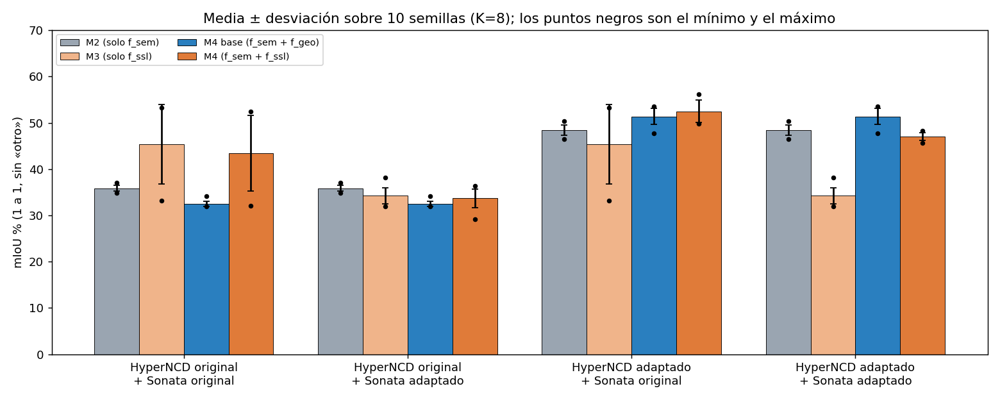
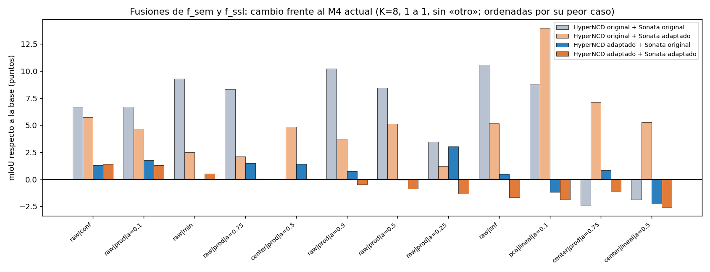
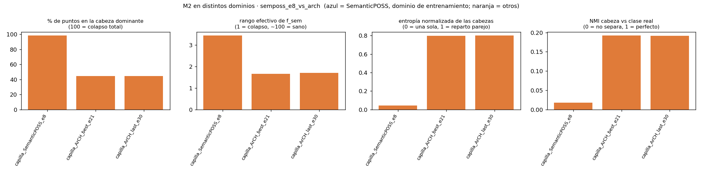
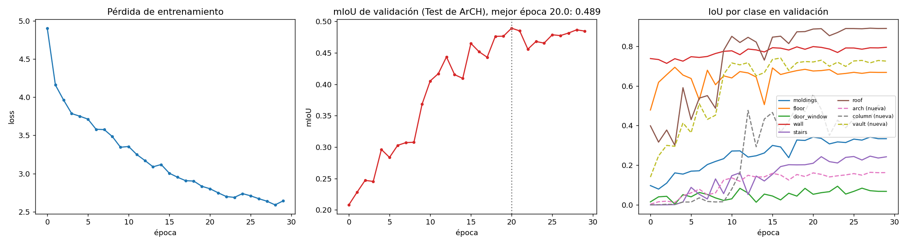
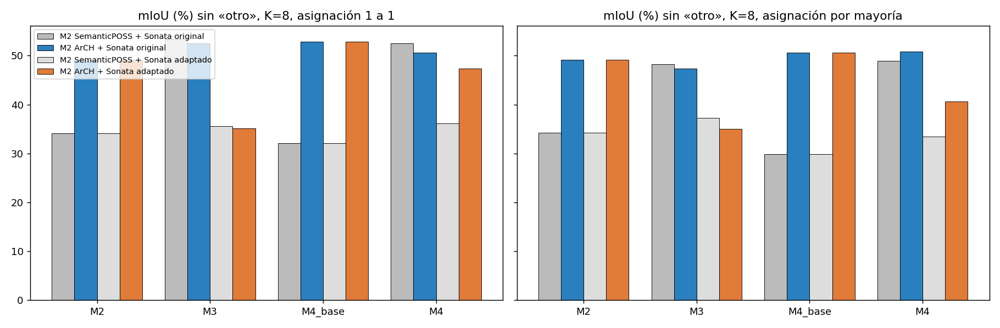

# Fusión de `f_sem` (M2) y `f_ssl` (M3) en el Módulo 4: banco de pruebas

**Pregunta.** Con un M2 que ya no colapsa (el entrenado en ArCH), M4 ya no supera a su línea base (M4 base 52,9 contra M4 50,6, mIoU 1 a 1). Cada fuente acierta clases distintas (arco con `f_sem`, cúpula con `f_ssl`). ¿Hay una forma **determinista y con respaldo en la literatura** de combinarlas mejor que el pegado actual?

**Cómo se fusiona hoy.** M4 pega `normalizar(f_sem)` y `normalizar(f_ssl)` y calcula afinidad coseno entre regiones (celdas de 0,75 m); es un promedio 50/50 de dos similitudes muy distintas, mezclado con una afinidad geométrica (peso 0,5).

## Qué se prueba y por qué (fundamento)

| Idea | Qué es | Respaldo |
|---|---|---|
| **Centrar y blanquear (PCA) antes del coseno** | Quitar la media y escalar los componentes principales a varianza 1; luego normalizar. Ataca la anisotropía: si casi todo está en una dirección (rango efectivo de `f_sem` ≈ 1,7) el coseno entre regiones sale alto y no separa. | La literatura de embeddings muestra que blanquear reduce la anisotropía y mejora la similitud coseno en recuperación y agrupamiento, pero puede dañar la clasificación por quitar estructura discriminativa (ver fuentes 3 y 4). Evidencia en agrupamiento, más débil: por eso se mide, no se asume. |
| **Fusión tardía de afinidades (lineal, ponderada)** | `S = a·cos_sem + (1−a)·cos_ssl`. | Es la «suma de kernels» del agrupamiento multivista (fuente 2); equivale a pegar los vectores con pesos. `a = 0,5` es el M4 actual. |
| **Producto / mínimo** | La similitud solo es alta si **ambas** fuentes coinciden. | Variante de acuerdo entre vistas; en la línea de la co-regularización (consenso entre vistas, fuente 2). |
| **Peso por confianza de M2** | Más `f_sem` donde las cabezas de M2 están seguras, más `f_ssl` donde no. | Ponderación adaptativa de vistas por fiabilidad (fusión tardía con pesos; fuente 2). Es heurística nuestra apoyada en esa idea. |
| **SNF (Similarity Network Fusion)** | Dos redes de similitud se refuerzan entre sí por difusión sobre vecinos locales hasta converger a una red fusionada. | Wang et al., Nature Methods 2014 (fuente 1); método estándar para agregar varias vistas de los mismos objetos. |
| **Peso de la geometría (`a_geo`)** | Cuánto entra la afinidad geométrica en `S_b`. | Parámetro propio de HyperNCD/M4; se barre en un segundo paso. |

**No incluido (por ahora):** agrupamiento espectral multivista con co-regularización (Kumar et al., NIPS 2011) y fusión con una red neuronal. La red encaja mejor en tesis 2 (ver más abajo). Trabajos de segmentación 3D no supervisada (PointDC, GrowSP, LogoSP) fusionan señal semántica de modelos autosupervisados con agrupamiento en **superpuntos/superpíxeles**, que es lo que ya hacemos con las regiones; sirven de apoyo para el diseño, no de método a copiar.

## Protocolo (para no sobreajustar con una escena)
1. Todo se calcula **por región** (≈3 800 regiones) y se cachea; cada configuración tarda ~1 s.
2. El agrupamiento **no usa etiquetas**. Las etiquetas solo evalúan.
3. La escena se parte en dos mitades espaciales **A y B**. Se **elige** la configuración con el mIoU de una mitad y se **reporta** en la otra (y viceversa); el promedio es la estimación honesta. Se reporta también media y desviación entre semillas (solo de la inicialización de Sinkhorn) y la estabilidad entre semillas (ARI).
4. **Validación del banco:** se recalcula el mIoU del M4 actual con este código y con el original (`m4_regiones`); deben coincidir.

## Cómo correrlo
```bash
python experimentacion/modulo4_fusion/barrido_fusion.py --nombre arch_original \
  --npy <capilla_etiquetada.npy> --fsem <fsem_arch.npz> --fssl <feats_original.npz> \
  --etiquetas <..._etiquetas.npy> --info <..._etiquetas.json> --salida experimentacion/modulo4_fusion/resultados \
  --verificar experimentacion/arch_entrenamiento/resultados/m4_capilla/m4_original/grupos_PL13.npz
```
Escribe `resultados/<nombre>/resultados.{json,csv}` y un `cache_regiones.npz` (no va a git).

## Resultados (10-nov-2026; una escena, K = 8, mIoU 1 a 1 sin `otro`)

### 1. Las cifras con una semilla engañaban (`referencias_semillas.{md,png,json}`, 10 semillas)

| Combinación | M2 | M3 | M4 base (`f_geo`) | M4 (`f_sem` + `f_ssl`) |
|---|---|---|---|---|
| HyperNCD original + Sonata original | 35,9 ± 0,6 | **45,4 ± 8,5** [33, 53] | 32,5 ± 0,6 | 43,4 ± 8,2 [32, 52] |
| HyperNCD original + Sonata adaptado | 35,9 ± 0,6 | 34,3 ± 1,7 | 32,5 ± 0,6 | 33,7 ± 2,1 |
| **HyperNCD adaptado** + Sonata original | 48,4 ± 1,1 | 45,4 ± 8,5 [33, 53] | 51,4 ± 1,7 | **52,5 ± 2,5** |
| **HyperNCD adaptado** + Sonata adaptado | 48,4 ± 1,1 | 34,3 ± 1,7 | 51,4 ± 1,7 | 47,0 ± 0,8 |

(«HyperNCD original» = M2 de SemanticPOSS; «adaptado» = M2 entrenado en ArCH. Sonata «adaptado» = reentrenado en la Catedral.)



1. **M3 solo es muy inestable** (45,4 ± 8,5): el 53,4 que se citaba era una semilla afortunada. Fusionarlo con `f_sem` lo **estabiliza** (M4: ± 2,5).
2. **Con un M2 sano el orden es M4 (52,5) > M4 base (51,4) > M2 (48,4) > M3 (45,4)**, pero M4 contra M4 base (+1,1) está dentro del ruido (desviaciones de 1,7 a 2,5). M4 sí supera a M3 (+7) y a M2 (+4).
3. **Con el M2 colapsado, `f_ssl` sí ayuda** a M4 frente a la línea base (43,4 contra 32,5: +11), aunque con mucha varianza (± 8,2). Es coherente con la idea original, pero la cifra de +20 de una semilla estaba inflada.
4. **Sonata adaptado sigue siendo peor**: M4 47,0 contra 51,4 de M4 base con el M2 sano.

### 2. Barrido de fusiones (`comparacion_combos.{md,csv,png}`; 39 configuraciones × 4 combinaciones × 5 semillas)
- **Ninguna fusión mejora de forma significativa con el M2 sano.** Las dos que mejoran en las 4 combinaciones y en ambas mitades de la escena son `raw|conf` (confianza de M2) y `raw|prod|a=0.1` (producto con peso 0,1 a `f_sem`): +6,6 y +6,7 con el M2 colapsado, pero solo **+1,3 a +1,8 con el M2 sano**, dentro de la desviación entre semillas (0,8 a 2,2).
- **Con el M2 colapsado las fusiones sí «rescatan»**: PCA con blanqueo, mínimo o SNF llevan a M4 de ~42 a ~50 (ver la tabla por combinación). El blanqueo quita la dirección dominante de un `f_sem` colapsado; con un `f_sem` sano no aporta y a veces perjudica (peor caso −16 puntos).
- **Protocolo honesto (elegir en una mitad, reportar en la otra):** con el M2 sano, −0,2 y +1,1 puntos; con el M2 colapsado, +8,8 y +18,2 (en parte porque su base es inestable).
- **Elegir la mejor configuración con las mismas etiquetas infla el resultado**: el «mejor» de una corrida (57,3) no se repitió con 5 semillas ni en otras combinaciones.



### Imágenes de los otros experimentos que llevan a este
| Qué | Imagen |
|---|---|
| M2 de SemanticPOSS contra M2 de ArCH en la capilla (cabeza dominante, NMI) |  |
| Curvas del entrenamiento de HyperNCD en ArCH |  |
| Una semilla: M2, M3, M4 base y M4 con cada M2 y cada Sonata (la que engañaba) |  |

### Qué se concluye
Con el M2 de ArCH, M4 ya funciona y **supera a M3 y a M2 por separado**, y es **mucho más estable** que M3. Pero **no supera de forma significativa a su línea base** (`f_sem` + `f_geo`), ni cambiando la fusión determinista. Mejorar más probablemente requiere un enfoque distinto (fusión aprendida, o más escenas para poder distinguir diferencias pequeñas), no un ajuste de pesos.

### Límites
Una sola escena y regiones fijas de 0,75 m (con tope ~86 a 89 % de mIoU por la forma de las regiones); las desviaciones son solo de la inicialización de Sinkhorn, no de escenas distintas; las etiquetas de la capilla se usan para emparejar grupos con clases. Los resultados completos están en `resultados/<combinación>/resultados.{csv,json}` (los `cache_regiones.npz` no van a git; se regeneran con el script).

### Cómo reproducir
```bash
# 4 combinaciones (HyperNCD original/adaptado × Sonata original/adaptado), 5 semillas
python experimentacion/modulo4_fusion/barrido_fusion.py --nombre <combo> --npy ... --fsem ... --fssl ... --etiquetas ... --info ... --salida experimentacion/modulo4_fusion/resultados --semillas 5
python experimentacion/modulo4_fusion/comparar_barridos.py        # tabla de consistencia entre combinaciones
python experimentacion/modulo4_fusion/referencias_semillas.py --semillas 10 && python experimentacion/modulo4_fusion/graficar_referencias.py
```

## Recomendado para Manyory: repetir las pruebas y comparar
Es un experimento más, pero conviene que otra persona lo repita para confirmar que los números no dependen de esta laptop. Cuesta unos 30 a 40 min y **no necesita GPU**.

**Qué hace falta** (todo está en el Drive del proyecto; ver `documentacion/drive_indice.md`):
- `m1/salida/capilla_etiquetada/` (el `.npy` y las etiquetas), `m3/salida/capilla_etiquetada/*_feats_{original,adaptado}.npz` (~1 GB cada uno) y `arch/entrenamiento/predicciones/capilla_etiquetada_last_fsem.npz` (M2 de ArCH). El M2 de SemanticPOSS está en `m2/salida/capilla_etiquetada/`.
- Python con `numpy scipy scikit-learn pandas matplotlib`.

**Pasos** (desde la raíz del repo; los comandos con todas las rutas están arriba en «Cómo reproducir»):
1. Correr `barrido_fusion.py` para las 4 combinaciones con `--semillas 5` (cada una ~5 min).
2. `python experimentacion/modulo4_fusion/comparar_barridos.py`
3. `python experimentacion/modulo4_fusion/referencias_semillas.py --semillas 10` y luego `graficar_referencias.py`.

**Qué debería salir** (si no coincide con una diferencia de más de ~1 punto, avisar; las semillas son fijas, así que deberían ser casi idénticos):

| Combinación | M4 (10 semillas) | M4 base |
|---|---|---|
| HyperNCD adaptado + Sonata original | 52,5 ± 2,5 | 51,4 ± 1,7 |
| HyperNCD adaptado + Sonata adaptado | 47,0 ± 0,8 | 51,4 ± 1,7 |

**Después:** comparar sus gráficos `resultados/referencias_semillas.png` y `comparacion_combos.png` con los de arriba, y anotar en este README (sección «Resultados») quién lo repitió, cuándo y si coincidió.

## Fuentes
1. Wang et al., *Similarity Network Fusion*, Nature Methods 2014 (documentación del paquete [SNFtool](https://rdrr.io/pkg/SNFtool/man/SNF.html)).
2. Kumar, Rai y Daumé, [*Co-regularized Multi-view Spectral Clustering*](https://papers.nips.cc/paper/4360-co-regularized-multi-view-spectral-clustering), NIPS 2011; [*A Survey on Multi-View Clustering*](https://arxiv.org/abs/1712.06246) (fusión temprana, tardía y suma de kernels).
3. [*Revisiting Cosine Similarity via Normalized ICA-transformed Embeddings*](https://arxiv.org/pdf/2406.10984) (preprocesado antes del coseno).
4. Resumen sobre [blanqueo con PCA](https://www.emergentmind.com/topics/pca-based-whitening-feature-refinement) (ventajas en similitud y riesgo en clasificación).
5. [GrowSP](https://arxiv.org/pdf/2305.16404), [PointDC](https://arxiv.org/pdf/2304.08965), [LogoSP](https://arxiv.org/html/2506.07857v1): segmentación 3D no supervisada con superpuntos.

**Nota:** las fuentes 3 a 5 las revisé por resúmenes de búsqueda, no leí los artículos completos; conviene leerlos antes de citarlos en la tesis.
