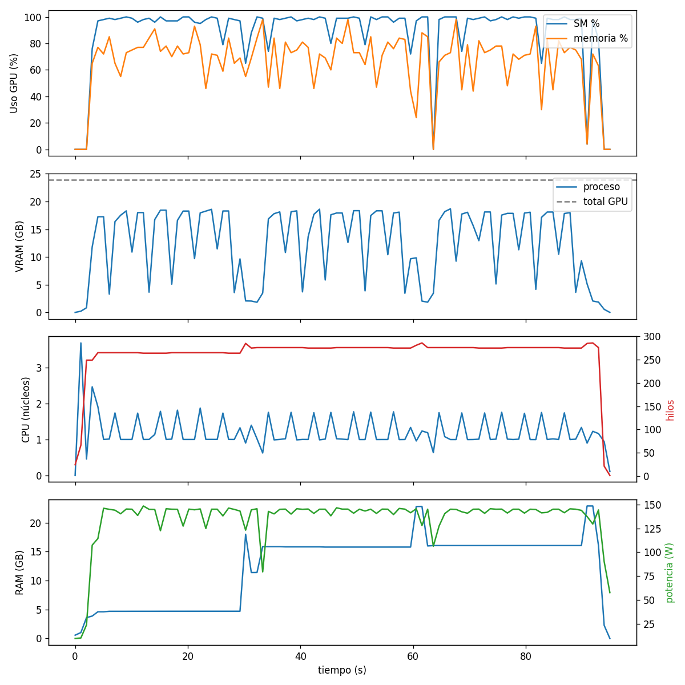
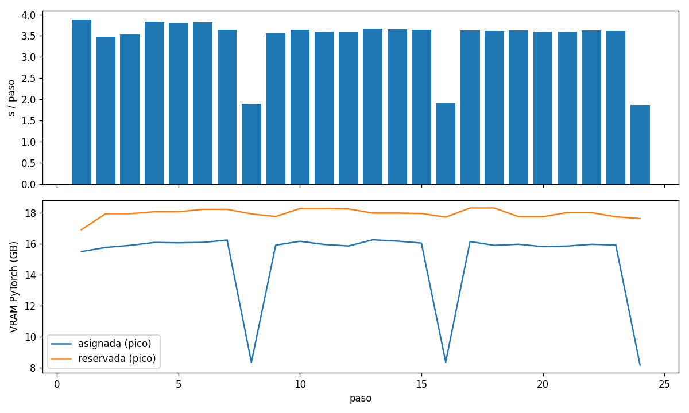

# Informe de recursos — entrenamiento HyperNCD (M2)

**Hardware:** NVIDIA RTX PRO 4000 Blackwell (8960 núcleos CUDA, 23.9 GB), pico FP32 teórico
≈ 36.8 TFLOP/s al reloj medio observado (2051 MHz). PyTorch 2.7.1+cu128, CUDA 12.8.
**Config:** batch 4, 4 workers, 479,187 puntos/paso (2 vistas).

| Métrica | Valor |
|---|---|
| Parámetros | 37,851,968 |
| FLOPs por paso (fwd+bwd) | 18.17 TFLOP |
| — convs dispersas (forward, exacto) | 5957 GFLOP |
| — operaciones densas (fwd+bwd) | 296 GFLOP |
| Tiempo por paso (mediana) | 3.63 s |
| Espera de datos (mediana) | 0.01 s |
| Rendimiento | 4.98 TFLOP/s (13.6% del pico) |
| Uso SM GPU (media / p95) | 93.72 % / 100.0 % |
| VRAM proceso (máx) | 18.7 GB |
| VRAM PyTorch pico asignada / reservada | 16.3 / 18.3 GB |
| Potencia (media / máx) | 140.5 / 148.4 W |
| CPU del proceso (media / máx) | 1.2 / 2.5 núcleos |
| Hilos (media / máx) | 273 / 286 |
| RAM del proceso, suma RSS (máx; sobreestima la memoria compartida con los workers) | 22.9 GB |
| RAM usada del sistema (máx) | 11.5 GB |

Los FLOPs de las convoluciones dispersas cuentan solo los pares activos del mapa de kernel.
Su backward se estima como 2 veces el forward. Las demás operaciones las mide `FlopCounterMode`.
